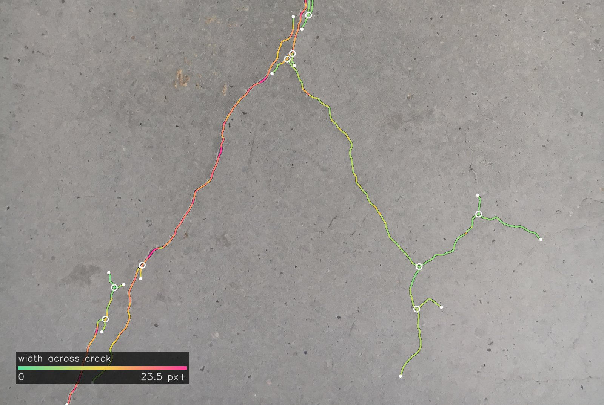
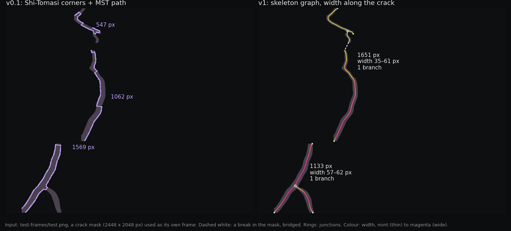
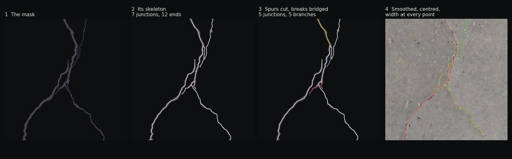
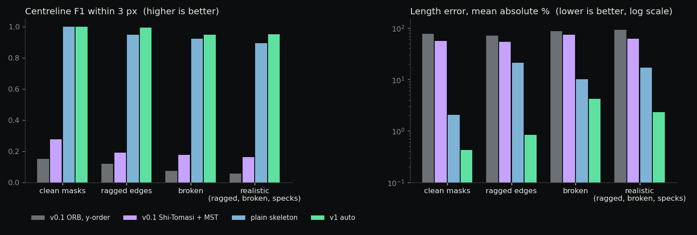
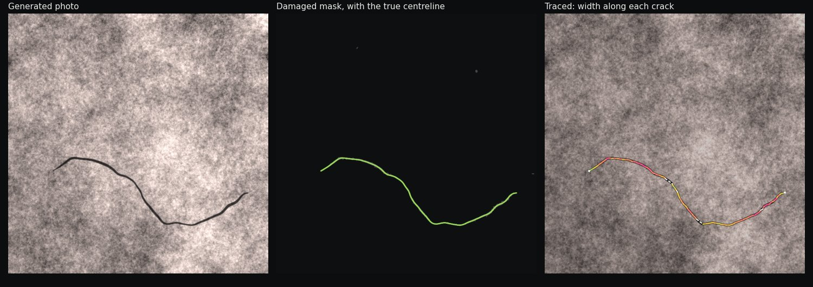
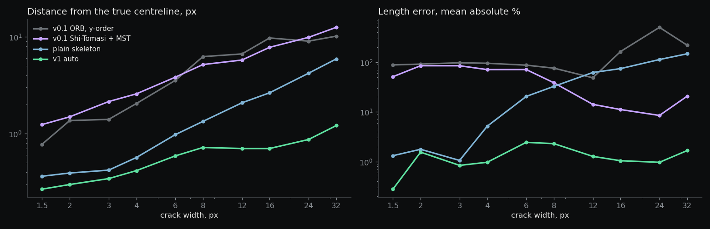
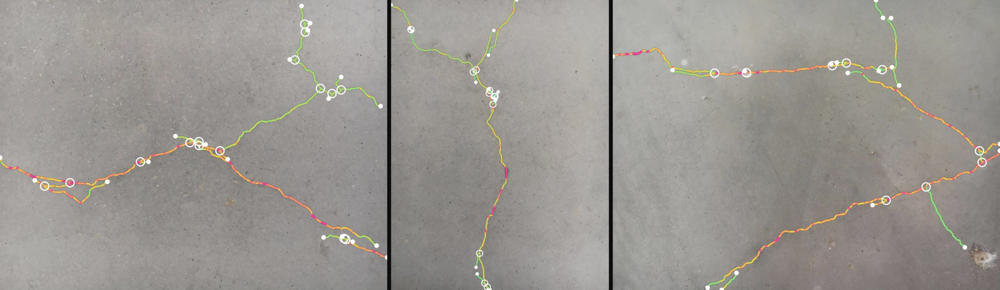

# fine-crack-tracing

Turns a crack segmentation mask into measured centrelines: where each crack runs, how long it is, how wide it is at every point along it, where it branches, and where the mask broke it.

[](https://github.com/Kronbii/fine-crack-tracing/actions/workflows/tests.yml)
[](pyproject.toml)
[](LICENSE)



*A wall from the Concrete Crack Segmentation Dataset (Özgenel, 2019, CC BY 4.0), traced from its hand-drawn mask. The colour is the crack's width at that point, mint (thin) to magenta (wide). Rings are junctions; dashed white stretches cross breaks in the mask.*

A segmentation model tells you which pixels are crack. An inspection needs the next layer: how long the crack is, how wide it gets, where it branches, and a line you can put on a drawing or compare with last year's. This package is that step. It takes any mask (binary, grey, colour, RGBA or a probability map) and returns each crack as a trunk and its branches, with the width measured across the crack at every point.

It is not a crack detector. It starts after segmentation, so any model can feed it.

## What changed in 1.0

The first release shipped only my starting point: Shi-Tomasi corners linked by a minimum spanning tree. In practice the approach that worked was to skeletonise the mask and fall back to corners only where a skeleton could not describe the crack. Version 1.0 is a rebuild around that, with everything a skeleton needs to hold up on real masks:

- **Skeleton graph.** Each crack is thinned to its centreline and read as a graph of free ends, junctions and the paths between them.
- **Spur pruning.** Ragged mask edges sprout short false branches on a skeleton. Side branches shorter than 2.5 local half-widths are cut, shortest first, so real branches stay.
- **Gap bridging.** When a segmentation break splits a crack, the pieces are joined if their ends face each other, with the allowed gap scaled to the crack's width. A loose end pointing into the side of another crack joins it as a junction. Bridged stretches are flagged in every output.
- **True ends.** A skeleton stops half a width short of each end of the mask; free ends are carried out to the tip.
- **Trunk and branches.** Every crack is split into its longest run and the branches off it, each with its parent.
- **Width along the crack.** At every point the mask is sampled across the crack and its two edges found to sub-pixel. The same profile re-centres the line.
- **Honest length.** Length is measured on a line smoothed in proportion to the crack's width, not on the pixel staircase, which overstates diagonal cracks by up to 8%.
- **The corner tracer, fixed.** Kept as `--method corners` and as the fallback in `auto`. Corners are now walked onto the centreline before they are linked, so a wide crack is traced down its middle rather than around its outline.
- **Physical units and width classes**, JSON / CSV / GeoJSON / SVG exports, overlays coloured by width, an evaluation command, a synthetic crack generator with exact ground truth, a benchmark, a Python API, tests and CI.

The full list, with what was fixed, is in [CHANGELOG.md](CHANGELOG.md).



## How it works



1. **Clean.** Binarise (with an optional hysteresis threshold for probability maps), drop specks, fill pinholes.
2. **Thin.** Skeletonise each crack. Diagonal steps that duplicate a path through a 4-neighbour are dropped first, so staircase corners do not read as junctions; clusters of junction pixels become one node.
3. **Prune.** Cut spurs shorter than 2.5 half-widths of the crack at their junction, shortest first, re-checking each junction as it goes.
4. **Check.** In `auto`, a skeleton whose discs rebuild less than 80% of its mask hands that crack to the corner tracer.
5. **Bridge.** Join facing ends across breaks (up to three crack widths, never less than 30 px), then ends that point into the side of another crack.
6. **Extend.** Carry free ends out to the tip of the mask.
7. **Split.** Take the longest end-to-end run as the trunk, then the longest run off what is already covered, until every edge belongs to one path.
8. **Smooth and centre.** Resample each path every pixel and smooth it along its length, more for wider cracks, whose skeletons wiggle with their ragged edges. Then shift the line to the middle of the mask across the crack, keeping only the slow part of that shift so the edge noise is not copied back in.
9. **Measure.** Width across the crack at every point (junction zones and bridges are left out of the statistics), length, orientation, tortuosity, branches, junctions, loops.

## Results

I can't score a centreline against a real mask, because real datasets label pixels, not lines. So the benchmark runs on synthetic cracks with exact ground truth: meandering, zig-zagging, branching cracks from 1.5 to 32 px wide whose true centreline and width are known at every point, rendered as masks and then spoilt the way segmentation output tends to be (ragged edges, breaks, pinholes, specks). Each tracer sees the same 100 images (768 x 768 px, 25 per preset); `fine-tracing bench` reproduces it, and the full table is in [docs/benchmark.md](docs/benchmark.md).

| tracer | F1 within 3 px | distance to the true line | length error | width error | junctions found / real |
|---|---|---|---|---|---|
| v0.1, ORB, sorted by y | 0.10 | 6.1 px | 82% | – | – |
| v0.1, Shi-Tomasi + MST | 0.20 | 5.6 px | 62% | – | – |
| plain skeleton | 0.94 | 1.5 px | 12.6% | 0.75 px | 90% / 42% |
| **v1 (auto)** | **0.97** | **0.52 px** | **1.9%** | **0.65 px** | **83% / 85%** |

*Averages over the four presets below. Length error is the mean absolute error of each image's total crack length. "Found" is the share of true junctions the tracer reports; "real" is the share of reported junctions that are true. The plain skeleton finds most junctions only because it reports every spur as one.*



On clean masks v1 sits 0.3 px from the true centreline on average, with length within 0.4% and width within 0.3 px. Ragged edges are where pruning and smoothing earn their place: a plain skeleton overstates length by 21% there, v1 by 0.8%, and only one in eight of the plain skeleton's junctions is real. Broken masks are where bridging matters; what is left there (4% short) is mostly crack the mask erased completely, which no tracer can recover. The v0.1 tracers miss most of every crack: with their default quality threshold they keep a few dozen corners for a whole crack, and on wide cracks those corners sit on the edges.





Width barely moves the result: across single cracks from 1.5 to 32 px wide, v1's length stays within 2.5% of the truth on average, while the v0.1 tracers drift further from the centre the wider the crack.

### On real photos

On real masks there is no true line to score against, so I ran two checks on all 458 hand-drawn masks of the Concrete Crack Segmentation Dataset (8 and 12 megapixels each):

- **What it finds.** 1,008 cracks; branches in 416 of the 458 images; 126 breaks in the masks bridged. The corner fallback was never needed. Each mask takes a median 0.63 s on one core of a laptop CPU.
- **How steady it is.** I damaged each mask the way a weaker model would leave it (ragged edges, breaks, pinholes, specks) and traced it again. Against the trace of the undamaged mask, the new trace scores a mean F1 of 0.96 within 3 px, sits a median 0.86 px away, and its total length changes by a median 0.75%.



## Quick start

Python 3.9 or newer.

```bash
git clone https://github.com/Kronbii/fine-crack-tracing.git
cd fine-crack-tracing
python -m venv .venv && source .venv/bin/activate
pip install -e .
```

Try it on the two walls in [examples/](examples):

```bash
fine-tracing trace examples/masks --photos examples/photos -o results/examples
```

```
wall-120                       2 crack(s)      5535 px long   max width 19.0 px      199 ms
wall-609                       2 crack(s)      5353 px long   max width 16.6 px      194 ms
```

Or a folder of your own masks, with the photos they came from (matched by file name) for the overlays:

```bash
fine-tracing trace data/masks --photos data/photos -o results/
```

With a known pixel size, everything comes out in millimetres, and width classes give the length of crack in each band:

```bash
fine-tracing trace data/masks --photos data/photos -o results/ --px-size 0.08 --width-classes 0.1,0.3,1
```

From Python:

```python
import cv2
from fine_tracing import trace

mask = cv2.imread("mask.png", cv2.IMREAD_UNCHANGED)
photo = cv2.imread("photo.jpg")
result = trace(mask, photo, px_size=0.08)  # 0.08 mm per pixel

for crack in result.cracks:
    w = crack.width_stats()
    print(crack.id, crack.pattern, f"{crack.length * 0.08:.1f} mm", f"max width {w['max'] * 0.08:.2f} mm")
    for path in crack.paths:          # trunk first, then branches
        path.points                   # (N, 2) x, y every pixel along the line
        path.width                    # (N,) width across the crack at each point, px

result.to_json("result.json")
```

## What it writes

| file | contents |
|---|---|
| `json/<image>.json` | every crack: length, width statistics, orientation, tortuosity, branches, junctions, ends, and every path's points, widths and bridged stretches |
| `cracks.csv` | one row per crack across all images |
| `geojson/<image>.geojson` | paths as LineStrings and junctions as Points, in image pixels |
| `svg/<image>.svg` | the traced lines, coloured by width, as vectors |
| `overlays/<image>.jpg` | the photo (or the mask) with the lines drawn on it |
| `centrelines/<image>.png` | the lines alone, one pixel wide, for other tools |
| `summary.json` | per-image totals, timing and the settings used |

## Settings

Every setting is a flag on `fine-tracing trace`, a field of `TraceConfig`, or a key in a JSON file passed with `--config`.

| flag | default | what it does |
|---|---|---|
| `--method` | `auto` | `skeleton`, `corners`, or `auto` (skeleton, with corners for any crack whose skeleton does not describe its mask) |
| `--px-size`, `--unit` | none, `mm` | size of one pixel, for physical lengths and widths |
| `--width-classes` | none | width class edges in output units; reports the length in each class |
| `--threshold` | 0.5 | mask threshold, as a fraction of full scale |
| `--hysteresis` | none | `low,high` thresholds for probability maps |
| `--prune` | 2.5 | cut side branches shorter than this many half-widths |
| `--max-gap` | auto | longest break to bridge, px (auto: three widths of the two ends, at least 30 px) |
| `--max-angle` | 45 | how far each end may turn to meet the other, degrees |
| `--no-bridge`, `--no-extend`, `--no-recentre` | | switch a stage off |
| `--smoothing` | 2 | smoothing along the line, px (wider cracks get up to one half-width more) |
| `--min-length` | 15 | drop cracks shorter than this, px |
| `-j` | 1 | images to trace in parallel |

## Scoring your own traces

`fine-tracing eval` scores traces (this tool's JSON, or any centreline images) against reference centrelines (JSON, or drawn centreline images): precision, recall and F1 within a tolerance, mean and 95th-percentile distance, length error, and width error and junction recall when both sides have them.

```bash
fine-tracing eval results/json data/reference --tol 3 -o scores/
```

`fine-tracing synth out/ -n 40 --preset realistic` writes synthetic photos, masks and exact ground truth. `fine-tracing bench -o bench/ -j 8` runs every tracer, v0.1 included, on fresh synthetic cracks and writes the tables and charts above.

## Repository layout

```
src/fine_tracing/
    pipeline.py   the tracing pipeline: trace(mask, image, ...)
    graph.py      skeleton graph, pruning, bridging, end extension, trunk and branches
    corners.py    the Shi-Tomasi corner tracer (fallback)
    geometry.py   resampling, smoothing, normals, widths across the crack
    mask.py       reading and cleaning masks
    result.py     TraceResult, Crack, Path; JSON, CSV, GeoJSON and SVG export
    render.py     overlays
    metrics.py    scores against reference centrelines
    synth.py      synthetic cracks with exact ground truth
    bench.py      the benchmark
    legacy.py     the v0.1 tracer, kept for the benchmark
    cli.py        the fine-tracing command
scripts/          make_figures.py (the images here), real_check.py (the real-mask check)
tests/            pytest suite
examples/         two walls from the Concrete Crack Segmentation Dataset (CC BY 4.0)
test-frames/      a sample crack mask
```

## Limits

- It measures the mask it is given. A mask that is a pixel too wide everywhere gives widths a pixel too wide; the width is only as good as the segmentation.
- Width is in pixels until you give it a pixel size, and a pixel size assumes the camera faces the surface square on. It does not correct perspective.
- Bridging guesses that two facing ends are one crack. Bridged stretches are flagged in every output so they can be counted separately or left out.
- Where cracks cross in an X, the crossing becomes two junctions a little apart, and the trunk-and-branch split there is a choice, not a fact.
- The synthetic benchmark is only as realistic as its generator. The real-mask check measures how steady the trace is, not how right it is.

## Credits

- Real photos and masks: Çağlar Fırat Özgenel, [Concrete Crack Segmentation Dataset](https://data.mendeley.com/datasets/jwsn7tfbrp/1), Mendeley Data, 2019, CC BY 4.0. The photos were taken in buildings at Middle East Technical University. The figures here show traced overlays of a few of them, resized, and [examples/](examples) holds two of them at half size.
- Thinning: Zhang and Suen's algorithm, through scikit-image.

## Links

- Project page: [ramikronbi.com/projects/fine-crack-tracing-toolkit](https://ramikronbi.com/projects/fine-crack-tracing-toolkit)
- Write-up: [Turning segmented cracks into measurable paths](https://ramikronbi.com/writing/turning-segmented-cracks-into-measurable-paths)

MIT License, see [LICENSE](LICENSE).

Built by Rami Kronbi — [ramikronbi.com](https://ramikronbi.com)
