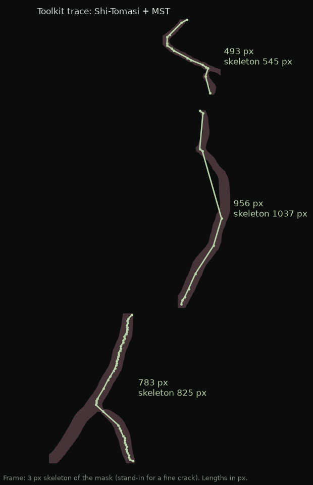
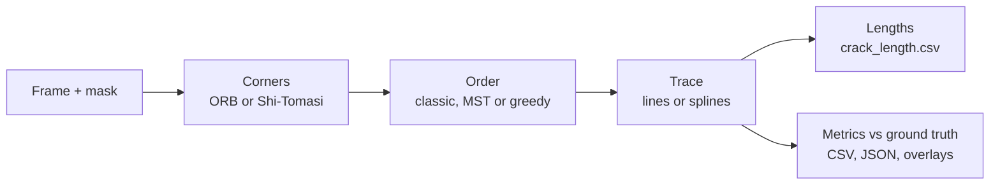
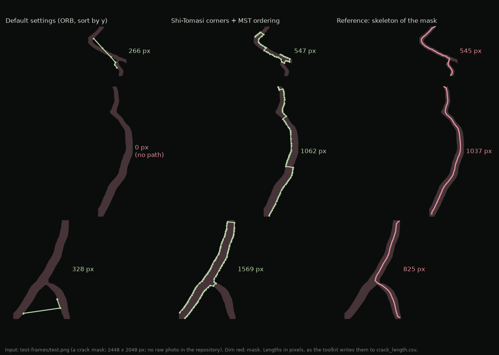

# fine-tracing: from crack masks to measurable paths

A segmentation mask says which pixels belong to a crack. Inspection needs the next layer: where the crack runs as an ordered line, how long it is, and how it compares with a reference. I built this installable Python package and CLI to produce exactly that.

[](pyproject.toml)
[](pyproject.toml)



*Given a thin crack image, Shi-Tomasi corners ordered by a minimum spanning tree follow the centreline, 5–10% short of a skeleton reference. The frame here is a 3 px skeleton of the mask, standing in for a fine crack.*

## What it is

Crack segmentation gives you a region; many inspection tasks need a path. They need to trace where the crack runs, smooth the trace without erasing the bends that matter, compare it with a reference, and export results that can be analysed outside a notebook. I built the toolkit from scratch for crack and damage extraction: not just a segmentation mask, but details you can measure.

It is not a crack detector. It starts after segmentation, which keeps it focused on geometry and evaluation and lets any segmentation model feed it.

## What it does

- **Ingest** raw frames and their pre-segmented masks, paired by file name.
- **Detect** candidate crack points with ORB or Shi-Tomasi corners.
- **Order** them with a classic approach, a minimum-spanning-tree path, or a greedy alternative, because no single heuristic fits every geometry.
- **Smooth** the trace with optional spline interpolation (degree 1–5).
- **Measure** each crack's length, written to `crack_length.csv`.
- **Evaluate** against ground-truth drawings with precision, recall, F1, IoU, mean and maximum distance and RMS error, exported as CSV and JSON with overlay images. The metrics keep their standard definitions.



## Quick start

Python 3.8 or newer.

```bash
git clone https://github.com/Kronbii/fine-crack-tracing.git
cd fine-crack-tracing
python -m venv .venv && source .venv/bin/activate
pip install -e .
```

Trace a folder of frames and their masks (a frame and its mask share a file name; PNG by default):

```bash
fine-tracing run \
  --frames-dir data/frames \
  --masks-dir data/masks \
  --output-dir results/run-a
```

The output folder gets the traced lines (`pure-lines-out/`), the detected corners, the lines drawn over each mask and frame, and `crack_length.csv`.

Then score the traces against ground-truth drawings:

```bash
fine-tracing metrics \
  --ground-truth data/ground-truth \
  --generated results/run-a/pure-lines-out \
  --output-dir results/run-a/metrics
```

That writes `_metrics.csv`, `_metrics.json` and an overlay per frame. Add `-v` or `-vv` before the subcommand for more logging.

Tracing options are set with environment variables:

| Variable | Values | Default |
|---|---|---|
| `FINE_TRACING_DETECTION` | `orb`, `shitomasi` | `orb` |
| `FINE_TRACING_SORT_METHOD` | `classic`, `MST`, `greedy` | `classic` |
| `FINE_TRACING_TRACING_METHOD` | `classic`, `int` (spline) | `classic` |
| `FINE_TRACING_INTERP_DEG` | 1–5 | 3 |
| `FINE_TRACING_ORB_FEATURES` | number of ORB features | 600 |
| `FINE_TRACING_METRIC_DIST` | distance threshold for metrics, px | 5 |

For example, the trace at the top of this page uses Shi-Tomasi corners with MST ordering:

```bash
FINE_TRACING_DETECTION=shitomasi FINE_TRACING_SORT_METHOD=MST \
  fine-tracing run --frames-dir data/frames --masks-dir data/masks --output-dir results/st-mst
```

All the settings live in [src/fine_tracing/config.py](src/fine_tracing/config.py). You can also drive it from Python:

```python
from fine_tracing import main as pipeline, config

config.frames_dir = "data/frames"
config.masks_dir = "data/masks"
config.frames_output_dir = "results/demo"
pipeline.main()
```

Tests: `pytest -q`.

## Give it a thin crack

The tracer needs a frame that shows the crack itself. Given only a thick mask as the frame, it traces the mask's outline, not its centreline, and with default settings ORB can find too few corners on a flat mask to draw a path at all:



*The same mask used as the frame. With default settings, ORB finds almost no corners on a flat mask and one crack is recorded as 0 px; Shi-Tomasi with MST ordering traces the mask's outline rather than its centreline.*

The sample in [test-frames/test.png](test-frames/test.png) is a crack mask, not a raw photo.

## Repository layout

```
src/fine_tracing/
    cli.py               fine-tracing command (run, metrics)
    main.py              the tracing pipeline
    process_corners.py   corner detection and ordering
    MST.py, greedy.py    ordering strategies
    metrics.py           precision, recall, F1, IoU, distances, RMS
    edge.py, preprocessing.py, utils.py
    config.py            settings and environment variables
tests/                   pytest suite
test-frames/             a sample crack mask
skeleton.py, sckit-skel.py, inpaint.py, interpolate.py   standalone experiment scripts
pyproject.toml           package and CLI entry point
```

## Limits and what's next

- It needs a frame that shows the crack. A thick mask alone gets its outline traced, not its centreline.
- It starts after segmentation and does not detect cracks.
- Configuration is global and set through environment variables; only the directories are CLI flags.
- Next: validation at dataset scale, across crack types, widths, branching patterns and imaging conditions.

## Links

- Project page: [ramikronbi.com/projects/fine-crack-tracing-toolkit](https://ramikronbi.com/projects/fine-crack-tracing-toolkit)
- Write-up: [Turning segmented cracks into measurable paths](https://ramikronbi.com/writing/turning-segmented-cracks-into-measurable-paths)

MIT License, see [LICENSE](LICENSE).

Built by Rami Kronbi — [ramikronbi.com](https://ramikronbi.com)
